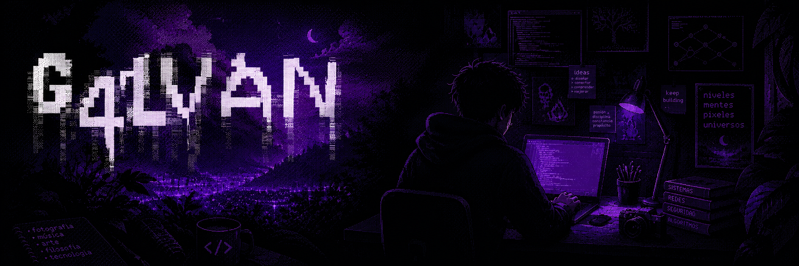
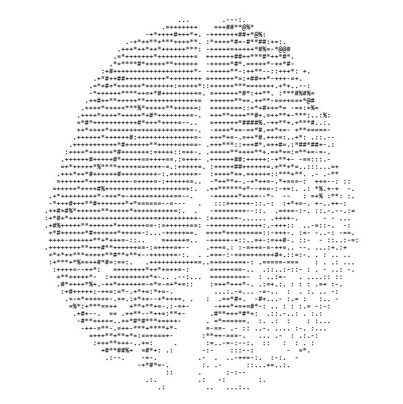

<div align="center">

<a href="https://github.com/g4lvan" target="_blank" rel="noopener noreferrer">
  
</a>

<br/>


<br/>


</div>

<br/>

## `>_` Sobre mí

```js
const g4lvan = {
  rol: "Desarrollador de software en formación",
  pais: "Colombia",
  enfoque: ["Backend", "Programación segura"],
  rumbo: "Seguridad de aplicaciones (AppSec)",
  aprendiendo: [
    "JavaScript",
    "HTML y CSS",
    "Algoritmos",
    "Arquitectura backend",
  ],
  principio: "Verificar antes de confiar.",
};
```

Construyo fundamentos sólidos en programación, ingeniería de software y desarrollo backend. Fortalezco JavaScript, HTML y CSS, y entreno la lógica, el pensamiento algorítmico y la resolución de problemas.

Mi rumbo es la **ciberseguridad**, en particular la **seguridad de aplicaciones**: unir el desarrollo con programación segura, análisis de vulnerabilidades y diseño de sistemas resilientes.

> **Aprendiendo hoy, construyendo lo que viene.**

<br/>

## `>_` Estado del sistema

<table>
  <tr>
    <td width="75%" valign="middle">

<pre>
$ estado --perfil g4lvan

[ >> ]  Fundamentos ......... lógica · algoritmos · estructuras de datos
[ >> ]  Desarrollo web ...... JavaScript · HTML · CSS
[ .. ]  Backend ............. Node.js · Express · APIs · datos
[ -- ]  Ciberseguridad ...... AppSec · programación segura · vulnerabilidades

>> en curso    .. siguiente    -- meta a largo plazo


$ git log --oneline

feat: profundizar en JavaScript
feat: preparar la transición a backend
feat: llevar el frontend hacia aplicaciones completas
fix: la seguridad no es opcional
</pre>

    </td>
    <td width="25%" align="center" valign="middle">
      
    </td>

  </tr>
</table>

<br/>

## `>_` Pila tecnológica

<div align="center">


<br/>

<sub><b>Base actual</b> · JavaScript · HTML · CSS · Git · GitHub · VS Code</sub>


<br/>

<sub><b>En exploración</b> · Node.js · Express · Linux</sub>

</div>

<br/>

## `>_` Áreas de interés

<div align="center">

| 🧱 **Backend e ingeniería de software** |           🔐 **Ciberseguridad / AppSec**           |          🐧 **Linux y herramientas**           |
| :-------------------------------------: | :------------------------------------------------: | :--------------------------------------------: |
|       APIs, datos y arquitectura        | Programación segura y análisis de vulnerabilidades | Entender las herramientas, no solo ejecutarlas |

</div>

<br/>

## `>_` Proyecto destacado

<table>
<tr>
<td>

### 📰 Rediseño del sitio web institucional · I.E.M. Emilio Cifuentes

Proyecto nacido como frontend y en proceso de convertirse en una **aplicación completa**.

**Ya incluye**

- Diseño responsive
- Estructura real de contenido
- Navegación funcional

**Hoja de ruta**

- Renderizado dinámico con JavaScript
- Consumo de datos (JSON / API)
- Backend con Node.js y Express
- CMS para gestión de contenido
- Buenas prácticas de seguridad desde el diseño (validación de entradas, manejo seguro de datos)

<a href="https://github.com/g4lvan/demo_page_colegio.github.io">
  
</a>

</td>
</tr>
</table>

<br/>

## `>_` Estadísticas de GitHub

<div align="center">


<br/>


</div>

<br/>

## `>_` Principios

- **Fundamentos antes que atajos.**
- **Proyectos reales** como método para desarrollar criterio técnico.
- **Experimentar y documentar** el proceso, incluidos los errores.
- **Seguridad desde el diseño.** Un sistema que funciona pero no resiste, no funciona del todo.

<div align="center">

<br/>

## `>_` Contacto

<a href="https://github.com/g4lvan"></a>
<a href="https://www.instagram.com/g4lvan_"></a>

<br/><br/>

<sub>Este perfil documenta mi proceso real de aprendizaje. Cada proyecto refleja mi progreso, no un resultado perfecto.</sub>


</div>
